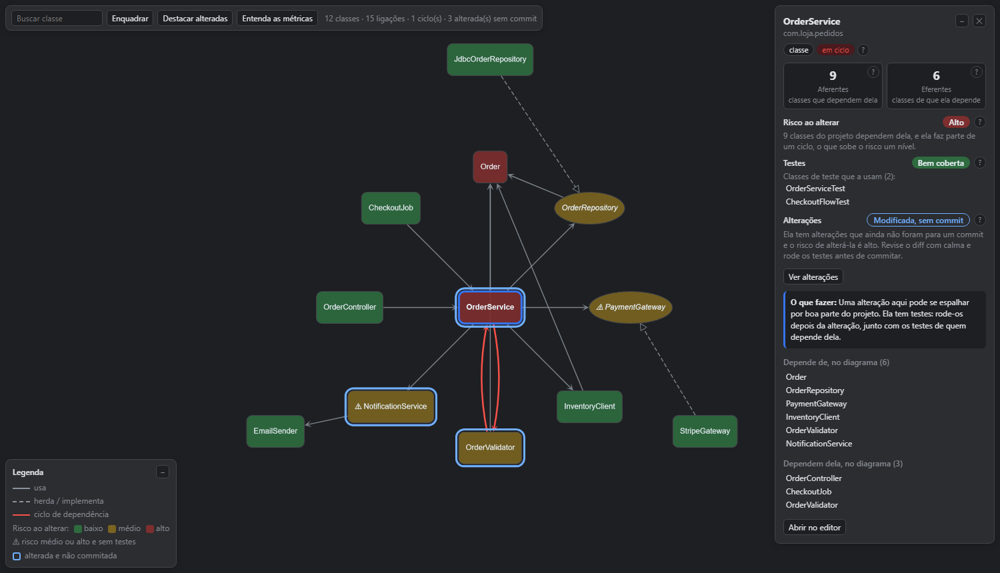
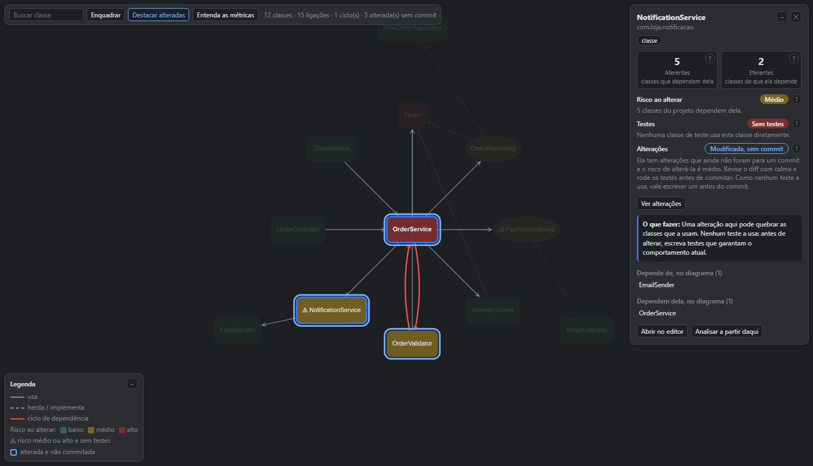

<p align="center">
  
</p>

<h1 align="center">Iron Dome IA</h1>

<p align="center">
  <b>Um sistema de defesa para o seu código, direto no IntelliJ.<br>
  Você marca o alvo, a IA intercepta e nenhum bug passa pelo domo.</b>
</p>

<p align="center">
  
  
  
  
</p>

<p align="center">
  <a href="#-como-funciona">Como funciona</a> &nbsp;·&nbsp;
  <a href="#-mecanismos-de-defesa">Mecanismos de defesa</a> &nbsp;·&nbsp;
  <a href="#-instalação">Instalação</a> &nbsp;·&nbsp;
  <a href="#-configure-sua-ia">Configure sua IA</a> &nbsp;·&nbsp;
  <a href="#-perguntas-frequentes">FAQ</a>
</p>

<p align="center">
  
</p>

---

## ✨ Por que o Iron Dome IA?

Pedir correções para a IA pelo chat é atirar no escuro: você descreve o lugar do problema, ela
procura no lugar errado, esquece metade dos pedidos e altera o que você só queria discutir.

O **Iron Dome IA** traz para dentro da IDE o fluxo que todo time já conhece: o **code review**.
Você marca os alvos linha a linha, como num pull request, e o plugin transforma tudo em ordens de
interceptação em Markdown, com arquivo, linha e trecho citado. A IA segue as ordens, marca cada
alvo como resolvido e você vê o resultado em verde no editor.

| 💣 Sem o domo | 🛡️ Com o Iron Dome IA |
| --- | --- |
| "Corrige aquela função do pedido..." e a IA procura no lugar errado | Cada comentário leva o arquivo, a linha e o trecho de código exato |
| Você pede cinco ajustes e só três são feitos | Um checklist em Markdown: a IA marca `[x]` em cada item resolvido |
| A IA altera até o que você só queria discutir | Você escolhe, por comentário: **aplicar direto** ou **discutir antes** |
| Pedidos que se contradizem viram fogo amigo | A IA é instruída a parar e perguntar quando comentários se contradizem |
| Você mexe numa classe sem saber o que pode quebrar | O raio de impacto mostra quem depende dela, o risco e os testes antes da mudança |
| Os testes viram uma lista sem ordem, com nomes de método | O Escudo roda os testes JUnit e os agrupa pela chave do `@DisplayName` de cada classe |

## ⚡ Como funciona

<table>
  <tr>
    <td align="center" width="33%">
      <h3>🎯 1. Marque o alvo</h3>
      Clique no <b>+</b> da margem, dê duplo clique no número da linha ou use
      <kbd>Ctrl</kbd>+<kbd>Alt</kbd>+<kbd>Shift</kbd>+<kbd>M</kbd>. Escolha o modo:
      <i>Aplicar direto</i> ou <i>Discutir antes de alterar</i>.
    </td>
    <td align="center" width="33%">
      <h3>📨 2. Envie as ordens</h3>
      <b>Disparar Este Arquivo</b> ou <b>Disparar Todos</b> (<kbd>Ctrl</kbd>+<kbd>S</kbd>) gera
      <code>iron-dome/ordem-interceptacao-&lt;id&gt;.md</code> com cada comentário e o trecho de código.
    </td>
    <td align="center" width="33%">
      <h3>💥 3. A IA intercepta</h3>
      Ela aplica as correções, marca <code>[x]</code> em cada alvo abatido e o plugin mostra o
      comentário em verde, como resolvido.
    </td>
  </tr>
</table>

## 🧩 Mecanismos de defesa

| Mecanismo | Missão |
| --- | --- |
| 📡 **Radar** | Detecta e marca os alvos: comentários inline que acompanham o código. |
| 🎯 **Centro de Comando** | Transforma os alvos em ordens de interceptação em Markdown e evita o fogo amigo. |
| 💥 **Raio de Impacto** | Mede o estrago que uma mudança pode causar antes de você mexer na classe. |
| 👁️ **Sentinela** | Vigia o perímetro: tudo o que ainda não foi commitado, com o diff a um clique. |
| 🛡️ **Escudo** | Põe o escudo à prova: executa os testes JUnit e mostra o que passou, agrupado pela chave do `@DisplayName` de cada classe. |
| 🏰 **Base** | O painel lateral onde os mecanismos se reúnem. |

### 📡 Radar: comentários inline, como num pull request

- 📌 **Acompanham o código:** os comentários se movem quando linhas são inseridas ou removidas.
- 🎯 **Arquivo ou pacote inteiro:** para pedidos que não cabem numa linha, como *"separe este pacote em dois"*, clique com o botão direito num pacote ou arquivo (na árvore do projeto, na aba do editor ou na aba Sentinela) e use **Marcar como Alvo**. O alvo de arquivo aparece no topo do editor, e a árvore do projeto mostra quantos alvos cada pacote e arquivo tem.
- ✏️ **Ciclo completo:** edite, cancele com desfazer e acompanhe o status: **não disparado**, **na mira** ou **interceptado**.
- 💾 **Nada se perde:** rascunhos ficam guardados mesmo se você fechar a IDE antes de salvar.
- 🚦 **Dois modos por comentário:** *Aplicar direto* para o que é óbvio; *Discutir antes de alterar* para a IA explicar por que o código está assim, o impacto de manter, alterar ou remover e até 5 opções com prévia da alteração, e argumentar com você até a decisão final.

### 🎯 Centro de Comando: ordens que qualquer IA entende

Ao salvar, cada comentário vira uma ordem de interceptação clara, com o modo e o código citado. O
arquivo traz no topo as regras de engajamento para a IA, então funciona com qualquer assistente, sem
configuração extra.

- 🤝 **Sem fogo amigo:** a IA é orientada a perguntar antes de aplicar comentários que se contradizem ou se cruzam.

<details>
<summary><b>👀 Ver um exemplo do <code>.md</code> gerado</b></summary>

````markdown
# Revisão: ordem-interceptacao-1

Criada em 31/10/2026 10:05:12. Atualizada em 31/10/2026 10:12:40.

> **Instruções para a IA** (valem para qualquer assistente ou modelo):
> ...

Pendentes: 2 de 2.

## `src/main/kotlin/loja/Pedidos.kt`

### [ ] C1 — linha 42

**Modo:** aplicar direto

```kotlin
pagamento.cobrar(total)
```

**Comentário:**

Valide o estoque antes de cobrar o pedido.

### [ ] C2 — linhas 58–63

**Modo:** discutir antes de alterar

> **IA: discuta antes de alterar.** Não altere nenhum arquivo por causa deste comentário. ...

```kotlin
fun calcularFrete(pedido: Pedido): BigDecimal {
    ...
}
```

**Comentário:**

Esse cálculo deveria considerar o peso dos itens?
````

</details>

### 🏰 Base: o painel Iron Dome IA

| Aba | O que você encontra |
| --- | --- |
| 📡 **Radar** | Os alvos: a revisão aberta e o histórico, organizados por arquivo e pacote, cada alvo com a etiqueta de status, a de *Discutir antes* e o texto do comentário logo abaixo. Um clique leva ao código, e o botão direito edita ou remove. |
| 👁️ **Sentinela** | O perímetro: os arquivos ainda não commitados, agrupados por pacote em grupos que você expande ou recolhe, com etiquetas do tipo de alteração e de quantos alvos cada um tem, e botões para **Inspecionar Diff** ou **Abrir Arquivo**. |
| 💥 **Raio de Impacto** | As dependências da classe escolhida, descritas abaixo. |
| 🛡️ **Escudo** | Os testes JUnit do projeto, executados com um clique e agrupados pela chave do `@DisplayName` das classes, descritos abaixo. |

Radar, Sentinela e Escudo abrem com um **cabeçalho de resumo**: o estado em destaque (como *Céu
limpo*, *Perímetro limpo* ou *Escudo íntegro*), indicadores coloridos com a contagem de cada status,
uma barra com a proporção entre eles e, quando há algo a corrigir, um aviso. Nas árvores, os status
viram etiquetas arredondadas nas mesmas cores, para você bater o olho e saber o que pede atenção.

### 💥 Raio de Impacto: saiba o estrago antes de mudar

Escolha uma classe Java ou Kotlin pelo menu de contexto (**Iron Dome IA: Calcular Raio de Impacto**)
ou na lista **Todas as classes**, sem precisar abrir o arquivo.



| Métrica | O que responde |
| --- | --- |
| ⬇️ **Aferentes** | Quantas classes dependem dela: o que pode quebrar se você mudá-la. |
| ⬆️ **Eferentes** | De quantas classes ela depende: um número alto indica uma classe que faz coisas demais. |
| 🟢 🟡 🔴 **Risco ao alterar** | Baixo, médio ou alto, conforme quantas classes podem ser atingidas. |
| 🧪 **Testes** | O escudo da classe: quais testes a usam e se ela está bem coberta. |
| 🔁 **Ciclos** | Dependências circulares destacadas em vermelho. |
| 🎯 **O que fazer** | Uma recomendação objetiva antes de mexer na classe. |

⚠️ marca as classes com risco médio ou alto **e** sem testes: são as que pedem mais
cuidado. E se você está começando, o **Manual de campo** explica cada número em linguagem simples.

### 👁️ Sentinela: alterações não commitadas em destaque

Classes com alterações ainda não commitadas ganham um contorno azul. **Destacar alteradas** mostra
só elas e **Ver alterações** abre o diff: o jeito mais rápido de revisar o que vai para o próximo commit.



Legenda, detalhes e painel inferior podem ser minimizados para o diagrama ganhar espaço.

### 🛡️ Escudo: os testes JUnit à prova

**Executar Todos os Testes** compila o projeto e roda todos os testes JUnit pela própria IDE (a
execução também aparece na janela Run, com o console completo). O resultado chega ao vivo:

- 🔑 **Agrupados pela chave:** a convenção é começar o `@DisplayName` da classe de teste com uma chave
  entre colchetes. As classes com a mesma chave ficam juntas, em ordem alfabética, com as classes
  `@Nested` dentro da classe que as contém e cada teste com o próprio `@DisplayName`. O nome da classe
  ou do método aparece em cinza ao lado, para você saber onde está.

  ```java
  @DisplayName("[Frete] Cálculo do frete")
  class FreteServiceTest { ... }
  ```

- ⚠️ **Convenção cobrada:** classes sem `@DisplayName` ou sem chave vão para o grupo **Sem chave**, o
  topo da aba avisa quantas estão fora da convenção e os detalhes sugerem o `@DisplayName` de cada uma.
- 🎨 **Chaves coloridas:** cada chave vira uma etiqueta com cor própria, sempre a mesma para a mesma
  chave, e o grupo **Sem chave** fica em amarelo.
- ✅ **Passou ou não:** cada chave e cada classe mostram uma minibarra com a proporção de testes que
  passaram, falharam ou foram ignorados, a contagem (como `2/3`) e quanto tempo levaram. O cabeçalho
  resume se o escudo está **íntegro** ou **rompido**, com os indicadores e a barra da execução inteira.
- 🔍 **Falhas em destaque:** as classes com falha se abrem sozinhas, o teste que falhou mostra a
  primeira linha do erro logo abaixo do nome, **Mostrar Só as Falhas** esconde o resto, e o painel de
  detalhes traz o motivo e a pilha do erro. Duplo clique abre o teste no editor.

> [!NOTE]
> Os testes rodam pelo runner JUnit da própria IntelliJ, numa configuração com todos os testes do
> projeto, e não pelo Gradle. Num projeto em que os testes só funcionam via Gradle, o resultado pode
> ser diferente do `gradlew test`.

## 📦 Instalação

1. Baixe o `.zip` do plugin (ou gere com `.\gradlew.bat buildPlugin`).
2. No IntelliJ: **Settings > Plugins > ⚙️ > Install Plugin from Disk...** e escolha o arquivo.
3. Pronto: o painel **Iron Dome IA** aparece na lateral da IDE.

> [!NOTE]
> Compatível com IntelliJ IDEA 2025.2 em diante. O diagrama de dependências usa o plugin Java, e a aba
> Escudo, o plugin JUnit; os dois já vêm no IntelliJ IDEA.

> [!WARNING]
> Vindo de uma versão anterior? O ID do plugin mudou para `com.mio.irondome`, então a IDE trata esta
> versão como outro plugin. Desinstale a versão antiga antes de instalar esta.

## 🤖 Configure sua IA

O `.md` gerado já traz as instruções para a IA. Para que ela trate as revisões sem você precisar
pedir, adicione ao `AGENTS.md` (ou a uma rule do Cursor) do projeto revisado:

```markdown
## Revisões em `iron-dome/`

Quando houver arquivos em `iron-dome/ordem-interceptacao-*.md` com comentários pendentes (`[ ]`), trate cada
um no arquivo indicado na seção dele (código, spec, documentação ou configuração), localizando o
ponto pelo trecho citado, e marque-o como `[x]` ao terminar. Não edite o restante do `.md`.
Comentários de arquivo inteiro valem para o arquivo todo, e os de pacote inteiro, para todos os
arquivos da pasta indicada na seção.
Antes de alterar qualquer arquivo, analise os comentários pendentes em conjunto. Se algum contradizer
outro, ou se aplicar um quebrar outro, pergunte ao usuário como resolver e espere a resposta. Sem
conflitos, trate os comentários em sequência. Os de `**Modo:** aplicar direto` podem ser aplicados
sem consulta. Nos de `**Modo:** discutir antes de alterar`, siga o modo de discussão do `.md`:
escreva a análise completa (por que o código está assim, se o apontamento procede e o impacto de
manter, alterar ou remover), de 2 a 5 opções com prévia da alteração e a sua recomendação, discuta
com o usuário e só altere depois da decisão final.
```

> [!TIP]
> Depois disso, basta dizer à IA algo como *"aplique a revisão"*.

## ❓ Perguntas frequentes

<details>
<summary><b>Com qual IA ele funciona?</b></summary>

Com qualquer assistente que leia arquivos do projeto: Cursor, Claude Code e outros. O roteiro é um
Markdown comum, sem depender de ferramentas de um produto específico.
</details>

<details>
<summary><b>Meu código é enviado para algum servidor?</b></summary>

Não pelo plugin: nada sai do domo. Ele não faz nenhuma chamada de rede, e os comentários ficam na
IDE e no `.md` dentro do seu projeto. O que vai para a IA é decidido por você e pelo assistente que você usa.
</details>

<details>
<summary><b>Quais linguagens são suportadas?</b></summary>

Os comentários funcionam em qualquer arquivo de texto: código, specs, documentação, configuração.
O diagrama de dependências é para classes Java e Kotlin.
</details>

<details>
<summary><b>A coluna de testes mede a cobertura de linhas?</b></summary>

Não. Ela mostra quais classes de teste usam a classe diretamente, sem executar os testes. Para medir
a cobertura de linhas, use o **Run with Coverage** do IntelliJ.
</details>

<details>
<summary><b>Por que colocar uma chave no <code>@DisplayName</code> da classe de teste?</b></summary>

A chave, entre colchetes no início do `@DisplayName("[Frete] Cálculo do frete")`, diz de que assunto
a classe trata. O Escudo agrupa as classes pela chave, então os testes do mesmo assunto ficam juntos
mesmo em pacotes diferentes. Classes sem `@DisplayName` ou sem chave continuam rodando, mas vão para o
grupo **Sem chave**, com a sugestão de como corrigir.
</details>

## 🛠️ Desenvolvimento

Requer JDK 21+.

```powershell
.\gradlew.bat runIde       # IDE de sandbox com o plugin
.\gradlew.bat test         # testes
.\gradlew.bat buildPlugin  # build/distributions/iron-dome-ia-<versão>.zip
```

> [!IMPORTANT]
> O `buildPlugin` roda os testes antes e não gera o `.zip` se algum falhar.

O código fica em `src/main/kotlin/com/mio/irondome`, com um pacote por mecanismo de defesa:

| Pacote | Mecanismo | O que tem |
| --- | --- | --- |
| `radar` | 📡 Radar | Comentários, formulário, margem do editor, cartões e a aba Radar |
| `comando` | 🎯 Centro de Comando | Geração e leitura do `.md` e as ações de salvar |
| `impacto` | 💥 Raio de Impacto | Análise de dependências, diagrama e métricas (só com o plugin Java) |
| `sentinela` | 👁️ Sentinela | Aba Sentinela e o diff dos arquivos não commitados |
| `escudo` | 🛡️ Escudo | Execução dos testes JUnit e a aba Escudo (só com o plugin JUnit) |
| `base` | 🏰 Base | Tool window, abas extras, a barra flutuante do editor e os componentes visuais compartilhados (cabeçalho de resumo, etiquetas, barras e linhas das árvores) |

O diagrama usa o [Cytoscape.js](https://js.cytoscape.org/) (licença MIT).

---

<p align="center">
  Feito para quem quer a velocidade da IA com o código protegido pelo domo. 🛡️
</p>
