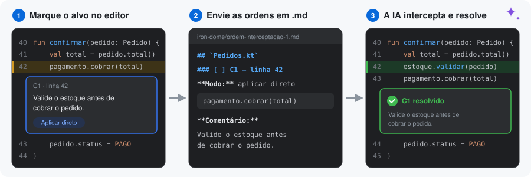
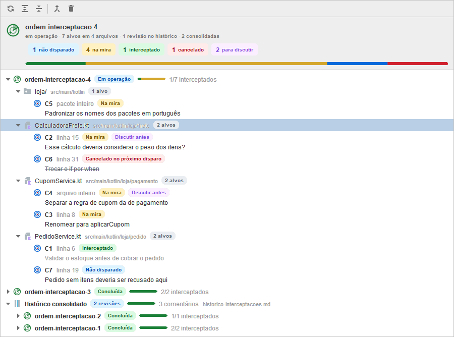
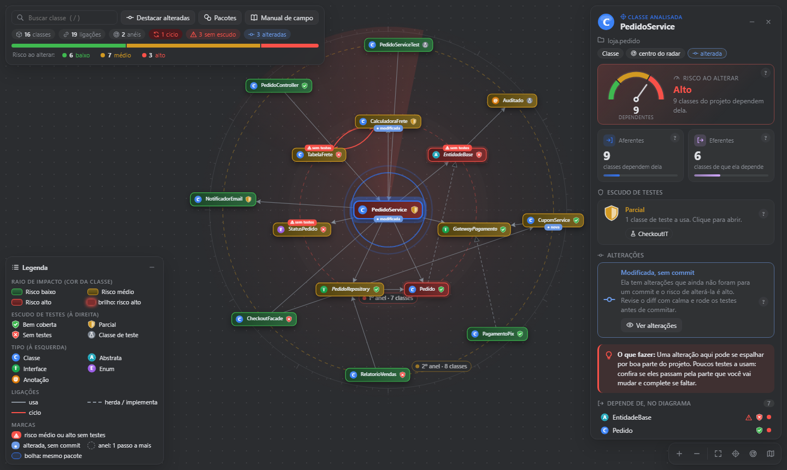
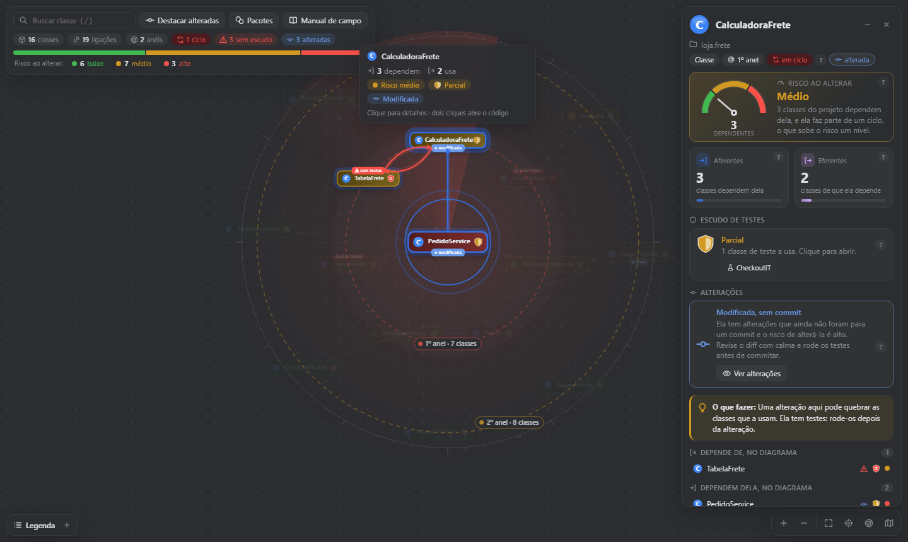
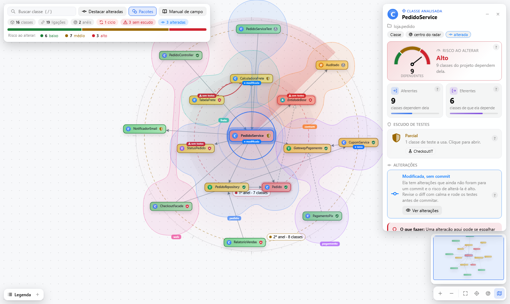
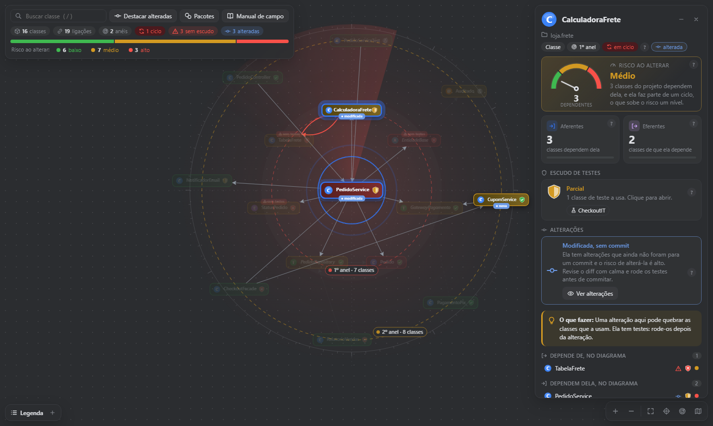
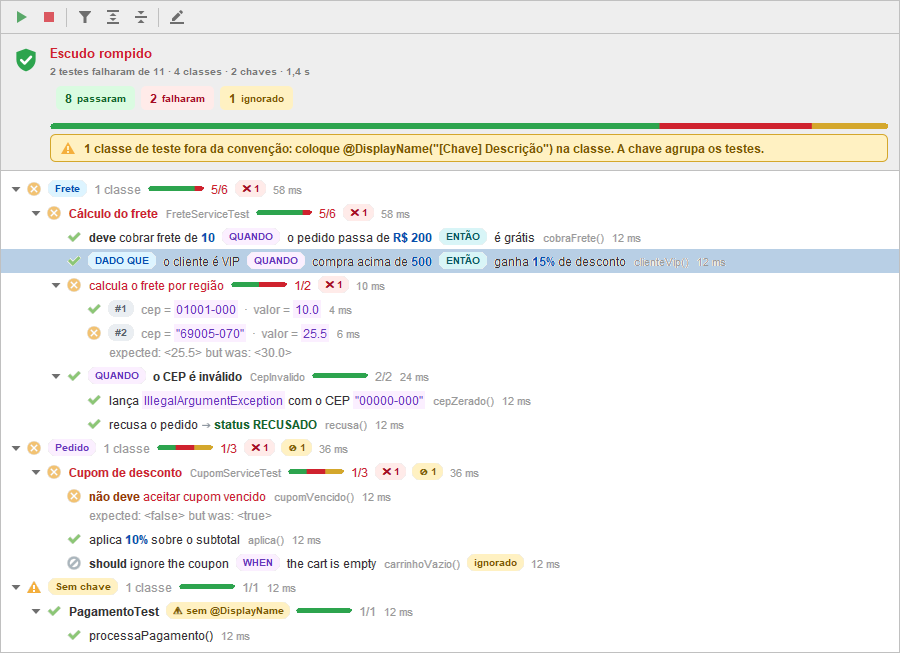
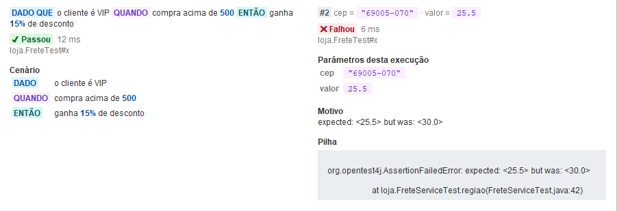

<p align="center">
  
</p>

<h1 align="center">Iron Dome IA</h1>

<p align="center">
  <b>Um sistema de defesa para o seu código, direto no IntelliJ.<br>
  Você marca o alvo, a IA intercepta e nenhum bug passa pelo domo.</b>
</p>

<p align="center">
  
  
  
  
</p>

<p align="center">
  <a href="#como-funciona">Como funciona</a> &nbsp;·&nbsp;
  <a href="#radar">Radar</a> &nbsp;·&nbsp;
  <a href="#centro-de-comando">Centro de Comando</a> &nbsp;·&nbsp;
  <a href="#raio-de-impacto">Raio de Impacto</a> &nbsp;·&nbsp;
  <a href="#sentinela">Sentinela</a> &nbsp;·&nbsp;
  <a href="#escudo">Escudo</a> &nbsp;·&nbsp;
  <a href="#patrulha">Patrulha</a> &nbsp;·&nbsp;
  <a href="#interceptador">Interceptador</a> &nbsp;·&nbsp;
  <a href="#instalacao">Instalação</a> &nbsp;·&nbsp;
  <a href="#configure-sua-ia">Configure sua IA</a> &nbsp;·&nbsp;
  <a href="#faq">FAQ</a>
</p>

<p align="center">
  
</p>

---

## ✨ Por que o Iron Dome IA?

Pedir correções para a IA pelo chat é atirar no escuro: você descreve o lugar do problema, ela
procura no lugar errado, esquece metade dos pedidos e altera o que você só queria discutir.

O **Iron Dome IA** traz para dentro da IDE o fluxo que todo time já conhece: o **code review**.
Você marca os alvos linha a linha, como num pull request, e o plugin transforma tudo em ordens de
interceptação em Markdown, com arquivo, linha e trecho citado. A IA segue as ordens, marca cada
alvo como resolvido e você vê o resultado em verde no editor.

| 💣 Sem o domo | 🛡️ Com o Iron Dome IA |
| --- | --- |
| "Corrige aquela função do pedido..." e a IA procura no lugar errado | Cada comentário leva o arquivo, a linha e o trecho de código exato |
| Você pede cinco ajustes e só três são feitos | Um checklist em Markdown: a IA marca `[x]` em cada item resolvido |
| A IA altera até o que você só queria discutir | Você escolhe, por comentário: **aplicar direto** ou **discutir antes** |
| Pedidos que se contradizem viram fogo amigo | A IA é instruída a parar e perguntar quando comentários se contradizem |
| As revisões antigas se acumulam na pasta do projeto | Um clique consolida o histórico num único arquivo, ou limpa tudo |
| Você mexe numa classe sem saber o que pode quebrar | O radar de dependências mostra quem depende dela, o risco e os testes antes da mudança |
| Os testes viram uma lista sem ordem, com nomes de método | O Escudo agrupa os testes pela chave do `@DisplayName` e destaca cada parte do nome |

<a id="como-funciona"></a>

## ⚡ Como funciona

<table>
  <tr>
    <td align="center" width="33%">
      <h3>🎯 1. Marque o alvo</h3>
      Clique no <b>+</b> da margem, dê duplo clique no número da linha ou use
      <kbd>Ctrl</kbd>+<kbd>Alt</kbd>+<kbd>Shift</kbd>+<kbd>M</kbd>. Escolha o modo:
      <i>Aplicar direto</i> ou <i>Discutir antes de alterar</i>.
    </td>
    <td align="center" width="33%">
      <h3>📨 2. Envie as ordens</h3>
      <b>Disparar Este Arquivo</b> ou <b>Disparar Todos</b> (<kbd>Ctrl</kbd>+<kbd>S</kbd>) gera
      <code>iron-dome/ordem-interceptacao-&lt;id&gt;.md</code> com cada comentário e o trecho de código.
    </td>
    <td align="center" width="33%">
      <h3>💥 3. A IA intercepta</h3>
      Ela aplica as correções, marca <code>[x]</code> em cada alvo abatido e o plugin mostra o
      comentário em verde, como resolvido.
    </td>
  </tr>
</table>

## 🧩 Mecanismos de defesa

Cada mecanismo é independente e tem uma aba própria no painel lateral **Iron Dome IA**.

| Mecanismo | Missão | Onde fica |
| --- | --- | --- |
| 📡 [**Radar**](#radar) | Marca os alvos: comentários inline que acompanham o código, e guarda o histórico de revisões. | Editor e aba Radar |
| 🎯 [**Centro de Comando**](#centro-de-comando) | Transforma os alvos em ordens de interceptação em Markdown e evita o fogo amigo. | Barra do editor e `iron-dome/` |
| 💥 [**Raio de Impacto**](#raio-de-impacto) | Mede o estrago que uma mudança pode causar antes de você mexer na classe. | Aba Raio de Impacto |
| 👁️ [**Sentinela**](#sentinela) | Vigia o perímetro: tudo o que ainda não foi commitado, com o diff a um clique. | Aba Sentinela |
| 🛡️ [**Escudo**](#escudo) | Executa os testes JUnit e mostra o resultado agrupado e com os nomes formatados. | Aba Escudo |
| 🛰️ [**Patrulha**](#patrulha) | Revisa os pull requests abertos no GitHub no modo revisão do PR, envia os pedidos de alteração e confere depois se foram atendidos. | Aba Patrulha |
| 🚀 [**Interceptador**](#interceptador) | Chama a IA pelo Cursor CLI ou Antigravity CLI para disparar alvos, revisar PRs, explicar falhas de teste e analisar bugs. | Ações com IA nas abas |
| 🏰 [**Base**](#base) | O painel lateral e os componentes visuais que os mecanismos compartilham. | Lateral da IDE |
| 📦 [**Caixa-Preta**](#caixa-preta) | Reporta bugs do próprio plugin: um `.md` dizendo onde foi o bug, com print, GIF e erros do log, enviado ao Linear. E confere se a IDE tem o que cada mecanismo precisa. | Topo do painel e menu Help |

---

<a id="radar"></a>

## 📡 Radar

O Radar cuida dos alvos de ponta a ponta: no editor, onde você comenta o código, e na aba Radar,
onde acompanha a revisão aberta e o histórico.

### No editor: comentários inline, como num pull request

- 📌 **Acompanham o código:** os comentários se movem quando linhas são inseridas ou removidas.
- 🎯 **Arquivo ou pacote inteiro:** para pedidos que não cabem numa linha, como *"separe este pacote
  em dois"*, clique com o botão direito num pacote ou arquivo (na árvore do projeto, na aba do editor
  ou na aba Sentinela) e use **Marcar como Alvo**. O alvo de arquivo aparece no topo do editor, e a
  árvore do projeto mostra quantos alvos cada pacote e arquivo tem.
- 🚦 **Dois modos por comentário:** *Aplicar direto* para o que é óbvio; *Discutir antes de alterar*
  para a IA explicar por que o código está assim, o impacto de manter, alterar ou remover e até 5
  opções com prévia da alteração, e argumentar com você até a decisão final.
- ✏️ **Ciclo completo:** edite, cancele com desfazer e acompanhe o status de cada alvo.
- 👁️ **Interceptados à vista ou não:** o **Ocultar** do cartão tira do editor um alvo já interceptado, e
  **Mostrar no Editor**, na aba Radar, traz de volta, inclusive os de revisões encerradas.
- 💾 **Nada se perde:** rascunhos ficam guardados mesmo se você fechar a IDE antes de salvar.

### Na aba Radar: a revisão aberta e o histórico

<p align="center">
  
</p>

A árvore mostra **revisão > arquivo ou pacote > comentário**. Um clique leva ao código, o duplo clique
foca o editor e o botão direito edita, cancela ou desfaz o cancelamento. O cabeçalho resume a revisão
aberta com um indicador por status e a barra de proporção entre eles.

| Etiqueta | Significado |
| --- | --- |
| 🔵 **Não disparado** | Comentário novo ou editado que ainda não foi para o `.md`. |
| 🟡 **Na mira** | Está no `.md`, esperando a IA. |
| 🟢 **Interceptado** | A IA marcou `[x]`: resolvido. |
| 🔴 **Cancelado no próximo disparo** | Você removeu; sai do `.md` no próximo salvamento. |
| 🟣 **Discutir antes** | A IA precisa discutir com você antes de alterar. |

### 🗄️ Histórico: consolidar e limpar

Cada revisão encerrada continua em `iron-dome/` como um `ordem-interceptacao-<id>.md`, e com o tempo a
lista cresce. Dois botões na barra da aba Radar resolvem isso:

| Botão | O que faz |
| --- | --- |
| 🔀 **Consolidar Histórico** | Junta todas as revisões encerradas em **`iron-dome/historico-interceptacoes.md`** e apaga os `.md` avulsos. Nada se perde: cada revisão vira uma seção, com os trechos de código e os comentários. Consolidar de novo acrescenta as novas revisões ao mesmo arquivo. |
| 🧹 **Limpar Histórico** | Apaga os `.md` das revisões encerradas e o histórico consolidado. Antes, mostra quantos comentários vão sair e avisa se algum ainda está pendente; a mesma janela oferece **Consolidar em Vez Disso**. |

- 🛡️ **A revisão aberta nunca entra:** só as encerradas são consolidadas ou apagadas.
- ♻️ **Recuperável:** a exclusão passa pela IDE, então os arquivos podem ser recuperados pelo **Local History**.
- 📚 **Aparece na árvore:** o nó **Histórico consolidado** mostra quantas revisões e comentários ele
  guarda e expande para cada revisão; duplo clique abre o arquivo.
- 🔢 **Sem números repetidos:** uma revisão nova não reaproveita um número que já está no consolidado,
  nem depois de clonar o projeto.

<details>
<summary><b>👀 Ver um exemplo do histórico consolidado</b></summary>

O histórico guarda o conteúdo das revisões sem as instruções para a IA, com um aviso de que não é uma
ordem de interceptação e a contagem de pendentes refeita a partir dos `[x]`.

````markdown
# Histórico de interceptações

> **Arquivo de histórico, não é uma ordem de interceptação.** Reúne as revisões encerradas que o Radar
> consolidou. IA: não aplique, não discuta e não marque os comentários daqui.

Consolidado em 01/11/2026 15:34:51. 2 revisões, 3 comentários.

| Revisão | Criada em | Comentários | Interceptados | Pendentes |
| --- | --- | ---: | ---: | ---: |
| ordem-interceptacao-2 | 01/11/2026 15:34:51 | 1 | 1 | 0 |
| ordem-interceptacao-1 | 01/11/2026 15:34:50 | 2 | 2 | 0 |

---

# Revisão: ordem-interceptacao-2

Criada em 01/11/2026 15:34:51. Atualizada em 01/11/2026 15:34:51.

Pendentes: 0 de 1.

## `src/Frete.kt`

### [x] C1 — arquivo inteiro
...
````

</details>

---

<a id="centro-de-comando"></a>

## 🎯 Centro de Comando

Ao salvar, cada comentário vira uma ordem de interceptação clara, com o modo e o código citado. O
arquivo traz no topo as regras de engajamento para a IA, então funciona com qualquer assistente, sem
configuração extra.

| Ação | Atalho | O que faz |
| --- | --- | --- |
| **Disparar Este Arquivo** | botão na barra do editor | Grava no `.md` só os comentários do arquivo aberto. |
| **Disparar Todos** | <kbd>Ctrl</kbd>+<kbd>S</kbd> ou a barra da aba Radar | Salva tudo e grava os comentários de todos os arquivos. |
| **Disparar Selecionados** | barra e botão direito da aba Radar | Só os alvos selecionados: um comentário, vários (<kbd>Ctrl</kbd>+clique), um arquivo ou a revisão. Grava os arquivos deles no `.md` e pede à IA que execute só esses alvos; sem a IA configurada, copia o pedido para você colar na sua. |
| **Disparar** | botão no cartão do alvo, no editor | O mesmo, só para aquele alvo. |

- 🤝 **Sem fogo amigo:** a IA é orientada a analisar os comentários em conjunto e a perguntar antes de
  aplicar comentários que se contradizem ou se cruzam.
- 🔁 **Volta automática:** quando a IA marca `[x]`, o plugin percebe a mudança no `.md` e mostra o
  comentário como resolvido no editor. Quando todos ficam resolvidos, a revisão se encerra e o próximo
  comentário abre uma nova.

<details>
<summary><b>👀 Ver um exemplo do <code>.md</code> gerado</b></summary>

````markdown
# Revisão: ordem-interceptacao-1

Criada em 31/10/2026 10:05:12. Atualizada em 31/10/2026 10:12:40.

> **Instruções para a IA** (valem para qualquer assistente ou modelo):
> ...

Pendentes: 2 de 2.

## `src/main/kotlin/loja/Pedidos.kt`

### [ ] C1 — linha 42

**Modo:** aplicar direto

```kotlin
pagamento.cobrar(total)
```

**Comentário:**

Valide o estoque antes de cobrar o pedido.

### [ ] C2 — linhas 58–63

**Modo:** discutir antes de alterar

> **IA: discuta antes de alterar.** Não altere nenhum arquivo por causa deste comentário. ...

```kotlin
fun calcularFrete(pedido: Pedido): BigDecimal {
    ...
}
```

**Comentário:**

Esse cálculo deveria considerar o peso dos itens?
````

</details>

---

<a id="raio-de-impacto"></a>

## 💥 Raio de Impacto

Saiba o estrago antes de mudar. Escolha uma classe Java ou Kotlin pelo menu de contexto
(**Iron Dome IA: Calcular Raio de Impacto**), com **Mirar Classe Atual** ou na lista **Todas as
classes**, sem precisar abrir o arquivo.

### O radar de dependências

<p align="center">
  
</p>

A classe analisada fica no centro do radar, e cada **anel** está um passo de dependência mais longe
dela; a etiqueta do anel diz quantas classes ele tem.

| Elemento | O que mostra |
| --- | --- |
| 🟢 🟡 🔴 **Cor da classe** | O risco ao alterar: baixo, médio ou alto. As de risco alto ganham um brilho vermelho. |
| 🅒 🅐 🅘 🅔 **@** **Ícone à esquerda** | O tipo: classe, abstrata, interface, enum ou anotação. |
| 🛡️ **Escudo à direita** | Os testes: bem coberta (✓), parcial (meio escudo), sem testes (✕) ou classe de teste (frasco). |
| ⚠️ **Etiqueta vermelha em cima** | Risco médio ou alto **e** nenhum teste: a classe que pede mais cuidado. |
| 🔵 **Etiqueta azul embaixo** | Alterações ainda não commitadas. |
| ➡️ **Setas** | Saem de quem usa para quem é usado; tracejadas para herança, vermelhas e curvas nos ciclos. |

O painel à direita detalha a classe selecionada: um **medidor de risco** com o número de dependentes,
aferentes e eferentes, o **escudo de testes** com as classes de teste que a usam, as alterações e uma
recomendação de **o que fazer** antes de mexer nela.

| Métrica | O que responde |
| --- | --- |
| ⬇️ **Aferentes** | Quantas classes dependem dela: o que pode quebrar se você mudá-la. |
| ⬆️ **Eferentes** | De quantas classes ela depende: um número alto indica uma classe que faz coisas demais. |
| 🎚️ **Risco ao alterar** | Baixo, médio ou alto, conforme quantas classes podem ser atingidas; estar num ciclo sobe um nível. |
| 🧪 **Testes** | Quais testes a usam e se ela está bem coberta. |
| 🔁 **Ciclos** | Dependências circulares destacadas em vermelho. |

### Explorando o diagrama

<table>
  <tr>
    <td width="50%"></td>
    <td width="50%"></td>
  </tr>
  <tr>
    <td><b>🖱️ Passe o mouse</b> numa classe: ela e os vizinhos acendem, o resto apaga e um cartão resume risco, dependentes e testes. Clique para os detalhes; dois cliques abrem o código.</td>
    <td><b>🫧 Pacotes</b> envolve as classes do mesmo pacote numa bolha colorida, e o botão de <b>mapa</b>, no canto, mostra um minimapa para navegar em diagramas grandes.</td>
  </tr>
</table>

- 🔎 **Busca:** <kbd>/</kbd> foca a busca, <kbd>Enter</kbd> leva à primeira classe encontrada.
- 🎚️ **Filtro por risco:** clique numa cor da barra de distribuição para destacar só as classes com aquele risco.
- 🧭 **Navegação:** aproximar, afastar, enquadrar, centralizar na classe analisada e reorganizar os anéis.
- 📖 **Manual de campo:** explica cada número, cor e ícone em linguagem simples.

### Alterações não commitadas em destaque

<p align="center">
  
</p>

**Destacar alteradas** apaga as demais classes e deixa só as que ainda não foram commitadas, e
**Ver alterações** abre o diff: o jeito mais rápido de cruzar o que vai para o próximo commit com o
risco de cada classe.

Legenda, detalhes e painel inferior podem ser minimizados para o diagrama ganhar espaço.

### Comentários e impacto apontado pela IA

As classes com comentários pendentes ganham um selo **✎** no canto: azul para os alvos do Radar e do Escudo,
roxo para os pedidos da Patrulha ao PR em revisão (os ainda não enviados e os enviados sem sinal de atendidos).
O selo acompanha o Radar e a Patrulha na hora, e os detalhes da classe listam cada comentário.

**Analisar Impacto com IA** (na barra da aba) manda para a IA as classes do diagrama, as ligações, os
comentários e o `git diff` das alterações sem commit, e ela aponta, **sem alterar nenhum arquivo**, quais classes
são afetadas se os comentários forem atendidos ou as alterações mantidas. No diagrama:

- ✦ **Brilho rosa** nas classes afetadas, mais forte quanto maior o impacto (alto, médio ou baixo), com o selo do
  nível no canto.
- 🔗 **Setas rosa** no caminho do impacto, entre as classes afetadas e as de onde ele parte.
- 📋 **Resumo da IA** no topo, com as classes afetadas da mais para a menos afetada (clique leva à classe), e
  **Destacar impacto**, que apaga o resto.
- 🔎 Nos detalhes e na dica de cada classe: o nível, o motivo e os comentários ou alterações que causam o impacto.

---

<a id="sentinela"></a>

## 👁️ Sentinela

A aba Sentinela vigia o perímetro: os arquivos ainda não commitados, em grupos que você expande ou recolhe.

- 🗂️ **Agrupar por:** raiz de código e pacote (como `src/main/kotlin` > `app.pedidos`), só pacote ou
  tipo de alteração. A escolha fica salva, e com mais de 20 arquivos os grupos de arquivos chegam
  recolhidos, para a lista não crescer demais.
- 🔎 **Busca e filtros:** a busca procura no nome, na pasta e no pacote; o botão **Filtrar** mostra só
  alguns tipos de alteração ou **Só com Alvos**. O cabeçalho avisa quantos arquivos o filtro está mostrando.
- 🏷️ **Etiquetas por arquivo:** o tipo de alteração (modificado, novo, movido, fora do git) e quantos
  alvos do Radar cada arquivo tem.
- 🔍 **Inspecionar Diff** abre o diff do arquivo, e **Abrir Arquivo** leva ao editor.
- 🎯 **Marcar como Alvo** direto da lista, para comentar um arquivo ou pacote inteiro.
- 🔄 **Sempre em dia:** a lista acompanha commits, edições e reverts sem precisar atualizar.

---

<a id="escudo"></a>

## 🛡️ Escudo

**Executar Todos os Testes** compila o projeto e roda todos os testes JUnit pela própria IDE (a
execução também aparece na janela Run, com o console completo). O resultado chega ao vivo.

<p align="center">
  
</p>

### Agrupados pela chave do `@DisplayName`

A convenção é começar o `@DisplayName` da classe de teste com uma chave entre colchetes. As classes com
a mesma chave ficam juntas, em ordem alfabética, com as classes `@Nested` dentro da classe que as
contém e cada teste com o próprio `@DisplayName`. O nome da classe ou do método aparece em cinza ao
lado, para você saber onde está.

```java
@DisplayName("[Frete] Cálculo do frete")
class FreteServiceTest { ... }
```

- 🎨 **Chaves coloridas:** cada chave vira uma etiqueta com cor própria, sempre a mesma para a mesma chave.
- 🏷️ **Agrupar por `@Tag`:** em **Agrupar Por**, na barra, a árvore pode vir por `@Tag` do JUnit (Tag → Chave →
  Classe → testes) ou pela chave do `@DisplayName`. Sem escolha, ela vem por tag quando os testes têm `@Tag`.
  Vale a tag do método; sem ela, a da classe (e da classe de fora, nas `@Nested`). `@Tags` e anotações próprias
  marcadas com `@Tag`, como um `@Lento`, também contam. Um teste com duas tags aparece nas duas, e os sem tag ficam
  em **Sem tag**. No agrupamento por chave, cada teste mostra as tags dele.
- ⚠️ **Convenção cobrada:** classes sem `@DisplayName` ou sem chave vão para o grupo **Sem chave**, o
  topo da aba avisa quantas estão fora da convenção e os detalhes sugerem o `@DisplayName` de cada uma.
- 🔧 **Deixar no Padrão:** marca as classes fora da convenção (as da seleção ou, sem nenhuma nela, todas) como
  alvos na revisão aberta do Radar, na linha do `@DisplayName` ou da declaração da classe. Esses alvos vêm
  assinalados como do Escudo: ícone do Escudo e etiqueta **Escudo** no editor, **Marcado pelo Escudo** na aba
  Radar e `**Origem:** Escudo` no `.md`, para a IA saber que não foi o revisor que pediu. O pedido traz as chaves
  que o projeto já usa, para a IA reaproveitar, e manda alterar só o `@DisplayName`. Mesmo no modo revisão de um
  PR, eles vão para o Radar, não para o PR, e uma classe que já tem alvo aberto do Escudo não é marcada de novo.

### Nomes dos testes formatados

O texto do `@DisplayName` de cada teste ganha destaque para você ler o cenário de relance:

| Escrito no `@DisplayName` | Como aparece |
| --- | --- |
| `Dado que…`, `quando…`, `então…` (ou `given`, `when`, `then`) | Etiquetas **DADO**, **QUANDO** e **ENTÃO** separando as etapas do cenário |
| `deve…`, `should…` / `não deve…`, `should not…` | Verbo da expectativa em negrito; o negativo em laranja |
| `` `código` `` e `"strings"` | Fundo lilás, como trecho de código |
| `IllegalStateException`, `…Error` | Fundo vermelho |
| Números e valores: `200`, `R$ 200`, `15%` | Azul em negrito |
| `soma 2 e 3 -> 5` (`->`, `=>`, `→`) | Seta destacada e o resultado esperado em verde |
| `[1] cep=01001-000, valor=10.0` (testes parametrizados) | Etiqueta **#1** e cada parâmetro com o valor destacado |

> [!TIP]
> "Dado" sozinho também quer dizer informação ("valida os dados do cliente"), então ele só vira etapa
> no início do nome ou na forma "dado que". "Quando" e "então" valem em qualquer posição.

<p align="center">
  
</p>

O painel de detalhes repete a formatação no título e, quando o nome tem essa estrutura, mostra o
**Cenário** em etapas (Dado, Quando, Então) e os **Parâmetros desta execução**, com nome e valor.

### Resultado e falhas

- ✅ **Passou ou não:** cada chave e cada classe mostram uma minibarra com a proporção de testes que
  passaram, falharam ou foram ignorados, a contagem (como `2/3`) e quanto tempo levaram. O cabeçalho
  resume se o escudo está **íntegro** ou **rompido**.
- 🔍 **Falhas em destaque:** as classes com falha se abrem sozinhas, o teste que falhou mostra a
  primeira linha do erro logo abaixo do nome, **Mostrar Só as Falhas** esconde o resto, e o painel de
  detalhes traz o motivo e a pilha do erro. Duplo clique abre o teste no editor.

> [!NOTE]
> Os testes rodam pelo runner JUnit da própria IntelliJ, numa configuração com todos os testes do
> projeto, e não pelo Gradle. Num projeto em que os testes só funcionam via Gradle, o resultado pode
> ser diferente do `gradlew test`.

---

<a id="patrulha"></a>

## 🛰️ Patrulha

A aba Patrulha revisa os pull requests do GitHub na IDE: no modo revisão do PR, os comentários que você faz
no editor vão para o PR, e não para a IA; você envia tudo como uma revisão e depois confere se cada pedido
foi atendido.

1. **Escolha o PR.** A aba lista os PRs abertos do remote do GitHub, com o autor, as branches e quantos
   pedidos já foram atendidos. Em cada PR, **Arquivos alterados** mostra o que mudou agrupado por pasta, com as
   pastas de um filho só juntas numa linha (como `src/main/kotlin/com/mio`): cada pasta soma os arquivos, as
   linhas `+`/`−` e os comentários, e cada arquivo vem com a cor e a etiqueta do status (novo, alterado,
   removido, renomeado). Pastas fechadas continuam fechadas quando a lista atualiza; duplo clique ou **Ver
   Alterações** abre o diff do PR numa aba, comparando com a mesma base do GitHub, e as setas do diff
   passam pelos demais arquivos. A conta é a que você já usa no IntelliJ (**Settings > Version Control >
   GitHub**). Se a organização bloquear o login pelo navegador (restrição a OAuth Apps), use **Entrar com
   Token** na aba, com um token pessoal classic com escopo `repo`.
2. **Revise.** **Revisar Este PR** traz o código do PR para a branch local `pr-<número>` e entra no modo
   revisão do PR; se você já está na `pr-<número>`, no head do PR, só entra no modo revisão. Outra branch no mesmo
   commit, como a do autor do PR, não conta: ela pode ter alterações não commitadas. O que não estiver commitado (fora de `iron-dome/` e
   `.idea/`) vai para o stash, com a lista dos arquivos e a sua aprovação antes. Não há botão de checkout
   à parte: se o PR receber commits novos, o mesmo botão vira **Atualizar ou Encerrar Revisão**.
   **Encerrar Revisão** oferece voltar para a branch de antes e devolver o stash. O modo revisão só vale na
   branch do PR: trocar de branch por fora da Patrulha (pelo Git da IDE ou pelo terminal) encerra a revisão na
   hora, e o aviso oferece **Voltar ao PR #n** e, se você voltou para a branch de antes, **Devolver as
   Alterações do Stash**. No modo revisão, o formulário de comentário fica roxo, com o título *Comentário para o PR #n*
   e o botão **Adicionar ao PR**, e os comentários ganham a etiqueta *Pedido para o PR #n · Não enviado*,
   fora do `.md` da IA. **Sugerir código** abre um editor de verdade sobre uma cópia do arquivo, com o
   trecho comentado destacado e editável e o resto do arquivo recolhido e só de leitura: Ctrl+Espaço,
   imports, navegação e erros funcionam como no editor, sem alterar o arquivo. Escreva como gostaria que
   ficasse: nas linhas do diff, vira uma sugestão do GitHub que o autor aplica com um clique
   (*Commit suggestion*); fora do diff, vai como código de exemplo.
3. **Envie.** **Enviar ao GitHub** mostra onde cada comentário vai entrar. Por padrão, eles vão como
   **rascunho no GitHub** (a revisão pendente, que só você vê): enviar de novo acrescenta ao mesmo rascunho,
   e **Editar**, **Excluir** e **Excluir Todos** valem lá também. Quando estiver pronto, **Publicar Rascunho**
   escolhe entre **Pedir Alterações** e **Só Comentar**, e o autor passa a ver. Desmarcando o rascunho, o envio
   já publica. Linhas que o PR altera viram comentários de linha; linhas fora do diff e arquivos inteiros,
   comentários do arquivo; pacotes e arquivos fora do PR entram no texto geral. Se o rascunho for publicado
   ou descartado pelo próprio GitHub, a Patrulha percebe na sincronização e atualiza o `.md`.
4. **Acompanhe no código.** Com a revisão ligada, os pedidos já enviados aparecem no editor como cartões
   recolhidos, onde o trecho está agora, com o status (*Enviado*, *Atendido*, *Sem alteração*). O
   cabeçalho expande, **Ocultar** tira o cartão e **Editar** troca o texto e o código sugerido também no
   GitHub. Na aba, **Mostrar/Ocultar no Editor** vale para o histórico do PR inteiro ou para um pedido, e
   **Editar** serve para rascunhos e pedidos enviados.
   Se o revisor **editar ou apagar** o comentário direto no GitHub, a Patrulha sincroniza ao atualizar a
   aba, ao iniciar a revisão e em **Verificar Pedidos**: o `.md` passa a ter o texto do GitHub (*Editado no
   GitHub*), e os apagados ficam riscados (*Apagado no GitHub*), fora das contas e sem Editar.
   **Excluir** apaga o comentário selecionado: o não enviado, o rascunho (no GitHub também) ou o publicado
   (no GitHub só se você escolher). **Excluir Todos** faz isso com o PR inteiro: os não enviados, o rascunho
   descartado no GitHub e os publicados, que só saem do GitHub se você marcar.
5. **Verifique.** Os pedidos ficam em `iron-dome/pull-requests/pr-<número>.md`. **Verificar Pedidos**
   confere cada um de dois jeitos:

| Verificação | Como funciona |
| --- | --- |
| 🧾 **Código** | Compara o trecho comentado com o arquivo no head atual do PR: *Como sugerido* (o head tem o código sugerido), *Alterado*, *Sem alteração*, *Só mudou de lugar*, *Arquivo removido* ou *Sem commits novos*. |
| 💬 **Conversa** | Lê a conversa do comentário no PR: *Resolvida*, *Respondida* (com a última resposta do autor) ou *Aberta*. |

Um pedido conta como atendido quando o código mudou ou a conversa foi resolvida; e como pendente quando
nada disso aconteceu depois de commits novos.

> [!NOTE]
> A Patrulha usa os plugins Git e GitHub que vêm no IntelliJ IDEA. Sem eles, a aba não aparece, e
> **Verificar Compatibilidade** mostra o motivo.

---

<a id="base"></a>

## 🏰 Base

O painel lateral **Iron Dome IA** reúne as abas Radar, Sentinela, Raio de Impacto e Escudo. Elas
compartilham os mesmos componentes visuais, para tudo ter a mesma cara:

- 📊 **Cabeçalho de resumo:** o estado em destaque (como *Céu limpo*, *Perímetro limpo* ou *Escudo
  íntegro*), indicadores coloridos com a contagem de cada status, uma barra com a proporção entre eles
  e, quando há algo a corrigir, um aviso.
- 🏷️ **Etiquetas arredondadas** nas árvores, nas mesmas cores dos indicadores, para você bater o olho e
  saber o que pede atenção.
- 🧰 **Barra flutuante do editor**, no canto superior direito: **Inspecionar Diff** quando o arquivo tem
  alterações não commitadas, e **Disparar Este Arquivo** e **Disparar Todos** enquanto há alvos não disparados.

---

<a id="interceptador"></a>

## 🚀 Interceptador (IA)

O Interceptador chama a IA direto da IDE, pelo CLI do **Cursor** (`agent`) ou do **Antigravity** (`agy`), rodando
na sua máquina sobre o projeto aberto. Enquanto ela trabalha, a aba que pediu (Radar, Patrulha, Escudo ou Raio de Impacto) e a
aba Interceptador mostram uma barra com o passo atual (como *Lendo src/Frete.kt*), o tempo, a última linha que a
IA escreveu e **Cancelar**; o ícone da aba e o do painel viram o ícone de IA, para dar para ver mesmo com o
painel fechado. Execuções sem aba própria, como as da Caixa-Preta, aparecem em todas as abas. Cada execução fica
registrada em `iron-dome/ia/` com o pedido, os passos, os arquivos alterados e a resposta (**Ver Resposta**).

No Windows, o CLI também pode estar no **WSL**: em **Onde está o CLI**, escolha **No WSL** e a distribuição (a lista
vem do `wsl.exe`, sem as internas do Docker Desktop). O plugin roda o CLI dentro dela pelo shell de login, que acha o
`agent` ou o `agy` em `~/.local/bin` (ou use o caminho do Linux em **Executável**), converte a pasta do projeto para
`/mnt/c/...` e repassa a chave de API do Cursor pelo ambiente. Vale para o teste, para a aba e para o terminal, e a
configuração automática procura também nas distribuições do WSL quando não acha o CLI no Windows.

Em **Onde rodar a IA** (na aba Interceptador ou em Settings), escolha **Na aba, em segundo plano**, **No terminal
da IDE** ou **Perguntar a cada vez**. No terminal, cada pedido abre uma aba do terminal com o CLI à vista: o Cursor
abre interativo, para acompanhar e conversar com a IA (vale o login do `agent login`; a chave de API não vai para o
terminal, para não ficar no histórico do shell), e o Antigravity roda o pedido e mostra a resposta. A IA grava a
resposta final em `iron-dome/ia/respostas/`, e o plugin segue dali como na aba: os rascunhos do Revisar com IA, a
análise no `bug.md`, os avisos. Enquanto isso, a barra da aba mostra **Mostrar Terminal** e **Parar de Esperar**.
Sem o plugin de terminal da IDE, a IA roda na aba.

Os dois caminhos têm teste, no Windows ou no WSL, como estiver configurado: **Salvar e Testar** confere a execução
em segundo plano (e habilita os botões de IA), e **Testar no Terminal** (na aba Interceptador, ou **Salvar e Testar
no Terminal** em Settings) abre a aba *IA: Teste* do terminal, pede à IA que grave OK num arquivo e mostra quanto
tempo ela levou e em qual shell rodou. Se a resposta não chega, a aba do terminal mostra o que deu errado: o
comando, o login ou o PATH.

| Onde | Ação | A IA pode alterar arquivos? |
| --- | --- | --- |
| 📡 Radar e barra do editor | **Disparar Todos com IA**: dispara os alvos e a IA executa a ordem de interceptação, marcando `[x]` nos atendidos. **Disparar Selecionados** (aba Radar) e **Disparar** (no cartão do alvo, no editor): a IA executa só os alvos escolhidos | Sim |
| 🛰️ Patrulha | **Revisar com IA** (no modo revisão): a IA lê os arquivos alterados e propõe comentários, que viram rascunhos para você revisar antes de enviar | Não |
| 🛡️ Escudo | **Explicar Falha com IA**: causa, onde e a correção proposta; a resposta oferece **Corrigir com IA** | Não (Corrigir: sim) |
| 💥 Raio de Impacto | **Analisar Impacto com IA**: as classes do diagrama afetadas pelos comentários do Radar e da Patrulha e pelas alterações sem commit, destacadas no diagrama | Não |
| 📦 Caixa-Preta | **Analisar com IA**, no bug gerado e em Ver Logs de Erro: causa provável e correção; no bug, a análise entra no fim do `bug.md` | Não |

Revisar não é alterar: **enquanto um PR está em revisão na Patrulha, a IA não altera o código**, porque o checkout
local é o do PR. Os disparos do Radar e o Corrigir com IA ficam desligados até você sair da revisão. E, em qualquer
pedido que altera código, a IA é instruída a não seguir os comentários de pull request (`iron-dome/pull-requests/`
e as revisões de PR em `iron-dome/ia/`); nos pedidos só de leitura, também no terminal, ela é instruída a não
alterar nada.

Na primeira vez que a aba **Interceptador** abre, a IA se configura sozinha: o plugin procura o Cursor CLI e o
Antigravity CLI instalados e testa cada um, com o modelo padrão, até um responder. Se nenhum responder, a
configuração manual abre já com o motivo de cada falha no cabeçalho. **Configurar Automaticamente** refaz essa
busca a qualquer hora, também em Settings.

Na configuração manual, na aba **Interceptador** do painel (ou em **Settings > Tools > Iron Dome IA > Interceptador (IA)**): o
CLI, o executável (vazio procura no PATH e nas pastas de instalação), o modelo, o tempo máximo e,
opcionalmente, a chave de API do Cursor (sem ela, vale o `agent login`). **Salvar e Testar** faz uma pergunta curta
à IA: **os botões de IA só se habilitam depois que o teste passa**, e trocar o CLI, o executável, o modelo ou a
chave pede um teste novo. A aba mostra o estado (*IA não configurada*, *Teste a integração*, *IA pronta*), quais
ações estão habilitadas e as execuções recentes, que abrem com duplo clique.

> [!NOTE]
> O `agy -p` do Antigravity pode travar quando chamado por outro programa
> ([issue 318](https://github.com/google-antigravity/antigravity-cli/issues/318)); o tempo máximo interrompe a execução.

---

<a id="caixa-preta"></a>

## 📦 Caixa-Preta

Achou um bug no Iron Dome IA? O botão da caixa-preta laranja no topo do painel (ou **Help > Reportar Bug do
Iron Dome IA**) abre um formulário com título, o mecanismo onde aconteceu, o que aconteceu, os passos e o que
era esperado.

- 📸 **Print:** a janela da IDE é capturada no momento do clique, antes do formulário abrir. Uma miniatura
  mostra o que vai junto, e você pode tirar.
- 🎥 **Gravação em GIF:** **Gravar GIF** esconde o formulário e grava a janela da IDE por até 30 s enquanto
  você reproduz o bug. **Parar Gravação**, na notificação, traz o formulário de volta.
- 🧭 **Onde foi o bug:** o `.md` aponta o pacote e a pasta do código do mecanismo e, se o `idea.log` tiver
  erros que passaram pelo plugin, a **origem provável**: o primeiro ponto do plugin na pilha do erro mais
  recente. Os erros vão no fim, com a pilha resumida aos frames que importam.
- 🧾 **Ambiente:** versões do plugin, da IDE, do Java e do sistema, os plugins Java e JUnit, o controle de
  versão, a aba ativa e o arquivo aberto.
- 📨 **Linear:** o relatório vira uma issue `[Bug] <mecanismo>: <título>` no projeto
  [Iron Dome AI](https://linear.app/mainio/project/iron-dome-ai-f447654e94fc/overview), com o print e o
  GIF anexados. Basta colocar a sua API key pessoal em **Settings > Tools > Iron Dome IA**. O time vem do
  próprio projeto, e o projeto pode ser trocado colando outra URL. **Testar Conexão** confere a
  configuração, e a API key fica no cofre de senhas da IDE.
- 💾 **Gerar só local:** em **Destino**, escolha entre enviar ao Linear ou **Gerar só local**, que cria o
  relatório sem rede e abre o `bug.md` no editor. Nos dois casos, cada relatório ganha uma pasta
  `bug-<data>/`, com o `bug.md`, o `print.png` e o `gravacao.gif`, dentro da **Pasta local**: por padrão
  `~/iron-dome-ia/bugs/`, com atalhos para a `iron-dome/bugs/` do projeto ou outra pasta qualquer. A pasta e o
  destino escolhidos ficam para o próximo relatório. Se o envio ao Linear falhar, a notificação oferece
  **Tentar de Novo**.

### 🩺 Verificar Compatibilidade

Nem toda IDE tem tudo o que os mecanismos precisam: o Raio de Impacto usa o plugin Java e o navegador
embutido (JCEF), e o Escudo, o plugin JUnit. Ao abrir o projeto, o Iron Dome IA confere isso e, se algum
mecanismo não vai funcionar, avisa qual e por quê, com **Ver Compatibilidade** e **Não Avisar de Novo**.

- 📜 **Iron Dome IA: Ver Logs de Erro** (menu **Help**, engrenagem do painel, abas que não abriram e
  Verificar Compatibilidade) lista os erros e avisos do plugin no `idea.log` (e no log anterior), agrupando
  as repetições, com o mecanismo, a origem no código e a pilha completa. Filtra por mecanismo e por nível e
  tem **Copiar Erro**, **Copiar Todos** (em Markdown, para colar numa conversa ou issue) e **Reportar Este
  Erro**, que abre o Reportar Bug com esse erro e o mecanismo dele.
- 🚨 Quando o plugin lança uma exceção, a janela de erros da própria IDE ganha o botão **Reportar ao Iron
  Dome IA**, que abre o Reportar Bug com o erro e a nota que você escreveu lá.
- 🆙 **Versão do IntelliJ:** ao abrir o projeto, o plugin confere se a IDE tem as APIs que cada mecanismo
  usa (testado com o IntelliJ 2025.2.6 ou mais novo). Se faltar alguma, pergunta: **Atualizar o IntelliJ**
  (abre a busca de atualizações) ou **Trabalhar Limitado**, que desliga só os mecanismos afetados; as abas
  deles mostram o que falta e o link para atualizar. A escolha vale até a versão da IDE mudar.

- 🩺 **Iron Dome IA: Verificar Compatibilidade** (menu **Help** ou engrenagem do painel) mostra a situação de
  cada mecanismo (OK, opcional, limitado ou indisponível), o que fazer para resolver e os erros recentes do
  plugin no `idea.log`, com **Copiar Diagnóstico**, **Abrir idea.log** e **Reportar Bug**.
- 🧯 **Uma aba com erro não derruba as outras:** se uma aba não abrir, o lugar dela mostra o erro, com
  atalhos para a verificação e para o Reportar Bug, e as demais abas e o botão de bug continuam no painel.

---

<a id="instalacao"></a>

## 📦 Instalação

1. Baixe o `.zip` do plugin (ou gere com `.\gradlew.bat buildPlugin`).
2. No IntelliJ: **Settings > Plugins > ⚙️ > Install Plugin from Disk...** e escolha o arquivo.
3. Pronto: o painel **Iron Dome IA** aparece na lateral da IDE.

> [!NOTE]
> Compatível com IntelliJ IDEA 2025.2 em diante. O Raio de Impacto usa o plugin Java, e a aba Escudo,
> o plugin JUnit; os dois já vêm no IntelliJ IDEA.

> [!WARNING]
> Vindo de uma versão anterior? O ID do plugin mudou para `com.mio.irondome`, então a IDE trata esta
> versão como outro plugin. Desinstale a versão antiga antes de instalar esta.

<a id="configure-sua-ia"></a>

## 🤖 Configure sua IA

O `.md` gerado já traz as instruções para a IA. Para que ela trate as revisões sem você precisar
pedir, adicione ao `AGENTS.md` (ou a uma rule do Cursor) do projeto revisado:

```markdown
## Revisões em `iron-dome/`

Quando houver arquivos em `iron-dome/ordem-interceptacao-*.md` com comentários pendentes (`[ ]`), trate cada
um no arquivo indicado na seção dele (código, spec, documentação ou configuração), localizando o
ponto pelo trecho citado, e marque-o como `[x]` ao terminar. Não edite o restante do `.md`.
Comentários de arquivo inteiro valem para o arquivo todo, e os de pacote inteiro, para todos os
arquivos da pasta indicada na seção.
Antes de alterar qualquer arquivo, analise os comentários pendentes em conjunto. Se algum contradizer
outro, ou se aplicar um quebrar outro, pergunte ao usuário como resolver e espere a resposta. Sem
conflitos, trate os comentários em sequência. Os de `**Modo:** aplicar direto` podem ser aplicados
sem consulta. Nos de `**Modo:** discutir antes de alterar`, siga o modo de discussão do `.md`:
escreva a análise completa (por que o código está assim, se o apontamento procede e o impacto de
manter, alterar ou remover), de 2 a 5 opções com prévia da alteração e a sua recomendação, discuta
com o usuário e só altere depois da decisão final.
O arquivo `iron-dome/historico-interceptacoes.md` é só histórico: não aplique nem marque nada nele.
```

> [!TIP]
> Depois disso, basta dizer à IA algo como *"aplique a revisão"*.

<a id="faq"></a>

## ❓ Perguntas frequentes

<details>
<summary><b>Com qual IA ele funciona?</b></summary>

Com qualquer assistente que leia arquivos do projeto: Cursor, Claude Code e outros. O roteiro é um
Markdown comum, sem depender de ferramentas de um produto específico.
</details>

<details>
<summary><b>Meu código é enviado para algum servidor?</b></summary>

Não pelo plugin: nada sai do domo. Os comentários ficam na IDE e no `.md` dentro do seu projeto, e o que
vai para a IA é decidido por você e pelo assistente que você usa. O plugin só usa a rede em dois casos: o
envio de um relatório de bug ao Linear, quando você configura o Linear e clica em **Enviar**, e a aba
Patrulha, que lê e comenta os pull requests do seu repositório no GitHub com a sua conta do IntelliJ.
</details>

<details>
<summary><b>A pasta <code>iron-dome/</code> vai encher de arquivos?</b></summary>

Não precisa. Na aba Radar, **Consolidar Histórico** junta todas as revisões encerradas num único
`historico-interceptacoes.md` e apaga os avulsos, e **Limpar Histórico** apaga o histórico de vez. A
revisão aberta nunca é tocada, e o que for apagado pode ser recuperado pelo Local History da IDE.
</details>

<details>
<summary><b>Quais linguagens são suportadas?</b></summary>

Os comentários funcionam em qualquer arquivo de texto: código, specs, documentação, configuração.
O Raio de Impacto é para classes Java e Kotlin.
</details>

<details>
<summary><b>A coluna de testes mede a cobertura de linhas?</b></summary>

Não. Ela mostra quais classes de teste usam a classe diretamente, sem executar os testes. Para medir
a cobertura de linhas, use o **Run with Coverage** do IntelliJ.
</details>

<details>
<summary><b>Por que colocar uma chave no <code>@DisplayName</code> da classe de teste?</b></summary>

A chave, entre colchetes no início do `@DisplayName("[Frete] Cálculo do frete")`, diz de que assunto
a classe trata. O Escudo agrupa as classes pela chave, então os testes do mesmo assunto ficam juntos
mesmo em pacotes diferentes. Classes sem `@DisplayName` ou sem chave continuam rodando, mas vão para o
grupo **Sem chave**, com a sugestão de como corrigir.
</details>

<details>
<summary><b>Como escrever o <code>@DisplayName</code> dos testes para aproveitar a formatação?</b></summary>

Descreva o cenário com as etapas e a expectativa, por exemplo
`@DisplayName("Dado que o cliente é VIP, quando compra acima de 500 então ganha 15% de desconto")` ou
`@DisplayName("não deve aceitar cupom vencido")`. Use crases para código (`` `null` ``) e uma seta para o
resultado esperado (`"soma 2 e 3 -> 5"`). Nada disso é obrigatório: um nome comum continua aparecendo
normalmente.
</details>

## 🛠️ Desenvolvimento

Requer JDK 21+.

```powershell
.\gradlew.bat runIde       # IDE de sandbox com o plugin
.\gradlew.bat test         # testes
.\gradlew.bat buildPlugin  # build/distributions/iron-dome-ia-<versão>.zip
```

> [!IMPORTANT]
> O `buildPlugin` roda os testes antes e não gera o `.zip` se algum falhar.

O código fica em `src/main/kotlin/com/mio/irondome`, com um pacote por mecanismo de defesa:

| Pacote | Mecanismo | O que tem |
| --- | --- | --- |
| `radar` | 📡 Radar | Comentários, formulário, margem do editor, cartões e a aba Radar |
| `comando` | 🎯 Centro de Comando | Geração e leitura do `.md`, histórico consolidado e as ações de salvar |
| `impacto` | 💥 Raio de Impacto | Análise de dependências, diagrama e métricas (só com o plugin Java) |
| `sentinela` | 👁️ Sentinela | Aba Sentinela e o diff dos arquivos não commitados |
| `escudo` | 🛡️ Escudo | Execução dos testes JUnit, formatação do `@DisplayName` e a aba Escudo (só com o plugin JUnit) |
| `patrulha` | 🛰️ Patrulha | Cliente do GitHub, checkout e revisão dos PRs, os pedidos em `.md` e as verificações de código, conversa e IA (só com os plugins Git e GitHub) |
| `caixapreta` | 📦 Caixa-Preta | Formulário de bug, print e gravação em GIF, leitura dos erros do plugin no `idea.log`, o `.md` do relatório, o envio ao Linear e a verificação de compatibilidade |
| `base` | 🏰 Base | Tool window, abas extras, a barra flutuante do editor e os componentes visuais compartilhados (cabeçalho de resumo, etiquetas, barras e linhas das árvores) |

O diagrama usa o [AntV G6](https://g6.antv.antgroup.com/) (licença MIT). As licenças de todas as
bibliotecas embutidas no `g6.min.js`, todas permissivas e livres para uso comercial, estão em
`src/main/resources/diagram/THIRD-PARTY-NOTICES.txt`, que vai junto no plugin.

---

<p align="center">
  Feito para quem quer a velocidade da IA com o código protegido pelo domo. 🛡️
</p>
